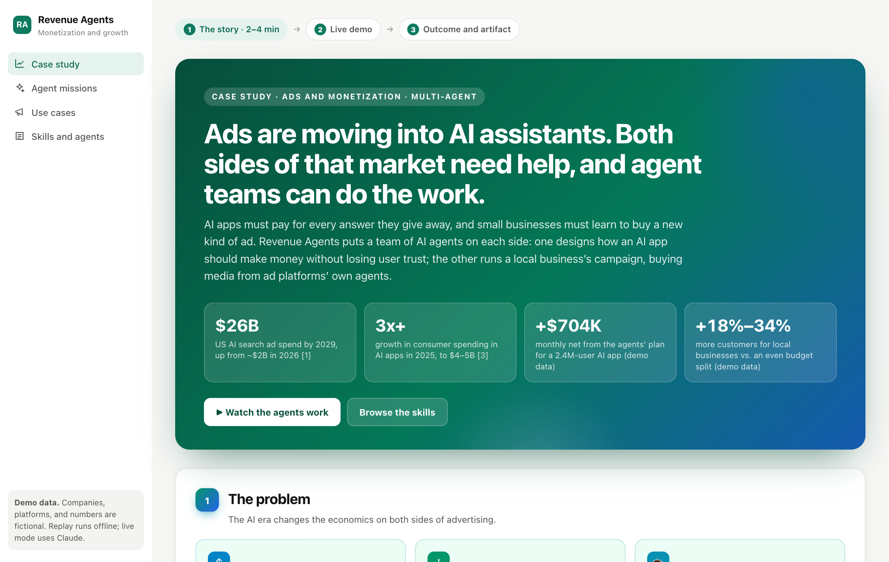
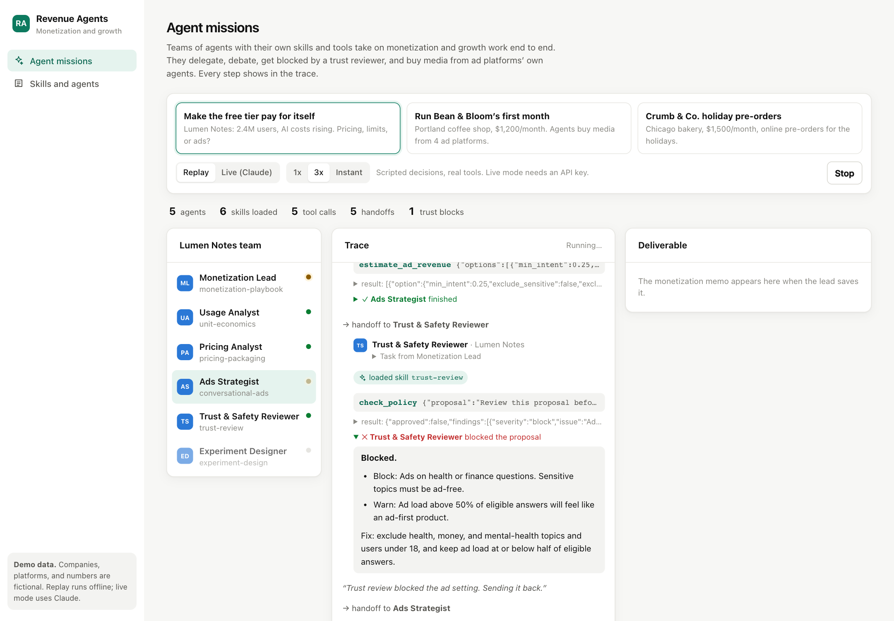

# Revenue Agents

**AI agent teams for the new AI ads market: one designs how an AI app makes money without losing user trust, the other runs a small business's ads across every platform, including AI assistants.**



## In one minute

| | |
|---|---|
| **Problem** | AI apps pay for every free answer, and the obvious fix, ads, can break trust. Small businesses have no team to buy ads across search, social, maps, and now AI assistants. |
| **Opportunity** | US ads in AI search grow from about $2B to **$26B by 2029** ([eMarketer](https://www.emarketer.com/content/ai-search-ads-surge-forward-while-advertisers-wait-proof)), and consumers already spend $4–5B a year in AI apps ([Sensor Tower](https://techcrunch.com/2026/01/21/consumers-spent-more-on-mobile-apps-than-games-in-2025-driven-by-ai-app-adoption/)). |
| **Solution** | A monetization team (with a built-in trust reviewer that can block a bad plan) and a campaign team that buys media directly from each ad platform's agent. |
| **Result (demo)** | **+$704K net per month** for a 2.4M-user AI app with no ads on sensitive topics, and **18–34% more customers** for local businesses on the same budget. |

## Executive summary

- **Why we built it.** Ads are moving into AI assistants. AI apps need a way to pay for free users without losing their trust, and small businesses need a way to buy this new kind of ad without a media team.
- **What we built.** Two agent teams on one platform. The monetization team designs pricing and ads for an AI app, and a trust reviewer can block any plan that puts ads where they don't belong. The campaign team plans, buys, and optimizes ads for a local business, buying directly from each platform's agent.
- **Why it matters.** The demo app adds about $700K a month without ads on health or money questions, and local businesses get 18–34% more customers on the same budget.
- **What it proves.** AI agents can make revenue decisions with guardrails built in: every number comes from a tool, every step is in the trace, and the trust rules are plain files the business owns and can audit.

## How it works

**Analyze → Design → Trust review → Test → Decide** for the AI app. **Research → Create → Buy from platforms → Optimize weekly → Report** for the business. Every agent follows a short written playbook (a "skill") that the business owns, and every step is visible in a live trace.



## See it

```bash
npm install
npm run dev
```

Open the app and click through: **Case study** (the story), **Agent missions** (live demo), **Use cases**, and **Skills and agents**.

It runs offline on sample data. Add `ANTHROPIC_API_KEY` to run the same agents live on Claude.

---

<sub>Built with React and TypeScript, a custom agent runtime with Agent Skills and agent-to-agent messaging, and the Anthropic API for live mode. All companies and figures in the demo are fictional. MIT license.</sub>
